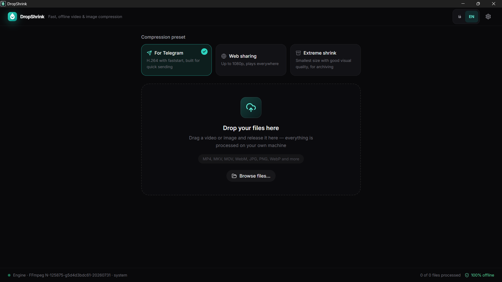
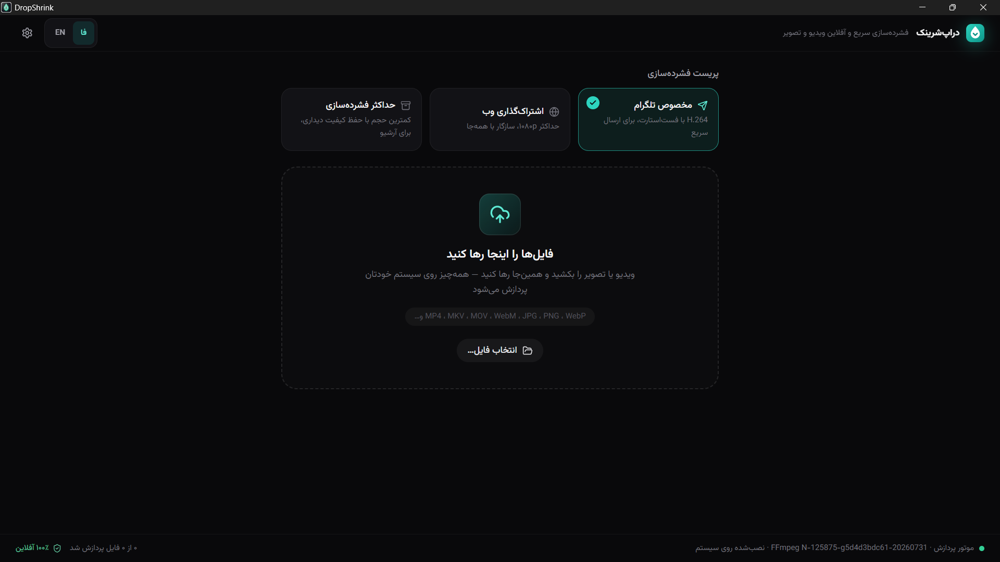
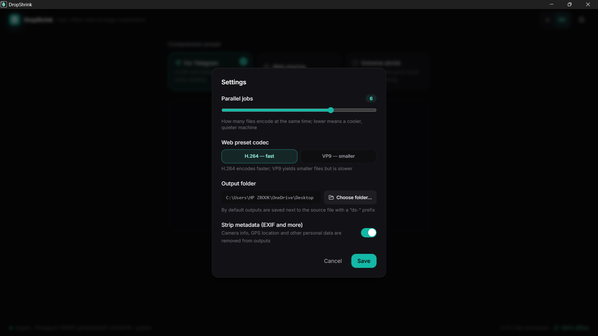
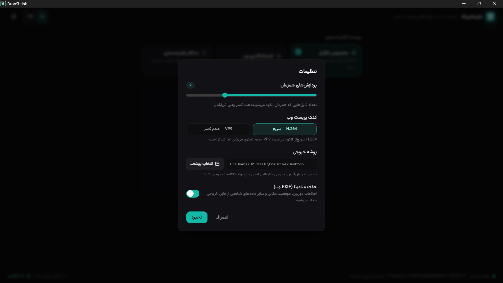

<p align="center">
  
</p>

<h1 align="center">DropShrink</h1>

<p align="center">
  <strong>Fast, offline video &amp; image compressor</strong><br />
  <em>فشرده‌ساز سریع و آفلاینِ ویدیو و تصویر</em>
</p>

<p align="center">
  <a href="https://github.com/SamRonin/dropshrink/actions/workflows/build.yml"></a>
  <a href="https://github.com/SamRonin/dropshrink/releases"></a>
  <a href="https://github.com/SamRonin/dropshrink/blob/main/LICENSE"></a>
  
  
</p>

<p align="center">
  <strong>English</strong> · <a href="README.md">فارسی</a>
</p>

## 📦 Introduction

**DropShrink** is a lightweight desktop app for **Windows, macOS and Linux** that turns video & image compression into a simple drag-and-drop. Its processing engine is **FFmpeg**, running entirely on your machine — your files never leave your computer.

Drop a large file into the window, pick a preset (e.g. "Telegram"), and collect the slimmed-down output moments later — with a live progress bar, an ETA, and per-file cancel/retry controls.

## ✨ Why DropShrink?

- **100% offline & private** — no network requests, no telemetry, no accounts; everything is processed locally with FFmpeg.
- **No command-line gymnastics** — you don't need to know codecs or CRF; three ready-made presets cover real-world situations.
- **A real processing queue** — drop many files at once; controlled parallelism keeps things fast.
- **One-toggle metadata stripping** — camera & location data (EXIF/GPS) are removed from the output.
- **Bilingual** — Persian (RTL) and English (LTR), with automatic system-language detection and bundled fonts (fully offline).


## 📸 Screenshots

<table>
  <tr>
    <td align="center" width="50%">
      
    </td>
    <td align="center" width="50%">
      
    </td>
  </tr>
  <tr>
    <td align="center" width="50%">
      
    </td>
    <td align="center" width="50%">
      
    </td>
  </tr>
</table>


## 🚀 Features

- 🖱️ Batch drag-and-drop + file picker
- 🎞️ Three video presets and three image presets
- 📊 Live progress bar parsed from FFmpeg's `-progress` output: percent, ETA, fps and bitrate
- ⏯️ Per-file cancel, retry and "reveal in folder"
- ⚙️ Controlled parallelism (1–8 concurrent jobs)
- 🧾 Output named `ds-<original-file>` next to the source file or in a folder of your choice
- 🔒 Metadata stripping (EXIF/GPS)
- ⚡ Hardware acceleration — GPU encoders detected automatically (NVIDIA NVENC, Intel QSV, VAAPI, VideoToolbox) with automatic CPU fallback on failure
- 🔍 Preview & compare — before/after slider or side-by-side diff for images and videos, including synchronized dual video playback
- 🛡 Size guard — if the output ends up larger than the input, it is removed and the user is clearly warned
- 🌐 Persian & English with full RTL/LTR support
- ⌨️ Keyboard shortcuts for common actions

## 🎮 Presets

### Video

| Preset | Video codec | Quality | Max dimensions | Audio | Notes |
| --- | --- | --- | --- | --- | --- |
| 📱 Telegram | H.264 (libx264) | CRF 24 | 1280px ‹1› | AAC 128k | 30fps cap + `-movflags +faststart` for instant streaming playback |
| 🌐 Web | H.264 (or VP9) | CRF 25 (VP9: CRF 32) | 1080p | AAC 96k (VP9: Opus) | Web codec is switchable in Settings to VP9; VP9 output is `.webm` |
| 🗄 Extreme | H.265/HEVC (libx265) | CRF 32 | Original resolution | AAC 64k mono | Smallest size with good visual quality; auto-falls back to H.264 CRF 28 if `libx265` is unavailable |

‹1› For portrait videos, the 1280px cap is applied to the vertical edge.

### Images

| Preset | Output format | Quality | Max dimensions |
| --- | --- | --- | --- |
| 📱 Telegram | JPEG | ≈80 | 1280px |
| 🌐 Web | WebP | ≈78 | 1920px |
| 🗄 Extreme | WebP | ≈55 | 1600px |

## ⬇️ Download & Install

Grab the latest version from the [Releases page](https://github.com/SamRonin/dropshrink/releases):

| Platform | Package |
| --- | --- |
| 🪟 Windows | MSI / EXE installer |
| 🍎 macOS (Apple Silicon) | DMG |
| 🍎 macOS (Intel) | DMG |
| 🐧 Linux | AppImage / DEB |

### Installing FFmpeg

As of the current version, the FFmpeg/FFprobe binaries are **bundled with the app as Tauri sidecars**, so a separate installation is usually unnecessary. Otherwise, DropShrink locates FFmpeg in this order:

1. Sidecar binaries shipped with the app (`ffmpeg-<platform>` next to the executable)
2. A `binaries/` folder next to the installed app (portable mode — you can drop your own `ffmpeg` and `ffprobe` there)
3. The app's resources directory
4. The system `PATH`
5. Common install locations (e.g. `C:\ffmpeg\bin`, `/opt/homebrew/bin`, `/usr/local/bin`…)
6. A folder you pick yourself in Settings ("FFmpeg folder")

If FFmpeg is not on your system, run one of the following:

```bash
# Windows (PowerShell)
winget install Gyan.FFmpeg
# or: download from ffmpeg.org and add it to your PATH

# macOS
brew install ffmpeg

# Linux (Debian/Ubuntu)
sudo apt install ffmpeg
# or your distro's equivalent
```

Then restart the app once.

## 💡 Usage

1. Drag video or image files into the window (or press `Ctrl/Cmd+O`).
2. Pick a preset — "Telegram", "Web" or "Extreme".
3. Watch each file's progress; you can cancel mid-encode, retry failed files, or reveal outputs in your file manager.
4. Outputs are saved as `ds-<original-name>` next to the source file (or in your chosen output folder).

Common formats are supported: MP4, MKV, MOV, WebM for video; JPG, PNG, WebP for images.

### ⌨️ Shortcuts

| Shortcut | Action |
| --- | --- |
| `Ctrl/Cmd + O` | Open files |
| `Ctrl/Cmd + ,` | Open Settings |
| `Ctrl/Cmd + L` | Switch language (فارسی / English) |

## 🛠 Settings

| Setting | Description | Default |
| --- | --- | --- |
| Concurrent jobs | How many files encode at the same time (1–8) | ≈ half of your CPU cores |
| Web preset codec | H.264 (faster encode) or VP9 (smaller files, slower encode, WebM output) | H.264 |
| Output folder | Next to the source file, or a folder you pick | Next to the source file |
| Strip metadata | Remove EXIF, location and other personal data from outputs; when disabled, metadata is carried over via `-map_metadata 0` | On |
| Hardware acceleration | Encode video on the GPU when a working encoder (NVENC/QSV/VAAPI/VideoToolbox) is detected, with automatic CPU fallback | On (when available) |
| FFmpeg folder | Manual path to a folder containing ffmpeg & ffprobe; used only when no bundled or system copy exists | Auto-detect |

## 🔒 Privacy

- No network requests, no telemetry, no accounts — never, anywhere.
- All processing happens on your device via FFmpeg; your files never leave your computer.
- Enabling "Strip metadata" removes camera and location information from outputs.
- Even the fonts (Vazirmatn & Inter) are bundled with the app, so nothing is fetched from the internet.

## 🧱 Building from Source

Prerequisites:

- **Rust** (stable, via [rustup](https://rustup.rs))
- **Node.js ≥ 18** + npm
- Linux only — the webkit system dependencies:

```bash
sudo apt install libwebkit2gtk-4.1-dev build-essential curl wget file \
  libxdo-dev libssl-dev libayatana-appindicator3-dev librsvg2-dev
```

Then:

```bash
git clone https://github.com/SamRonin/dropshrink.git
cd dropshrink
npm install
bash scripts/fetch-binaries.sh   # fetch sidecar binaries for your platform (Windows: scripts/fetch-binaries.ps1)
npm run tauri dev    # run in development mode
npm run tauri build  # build installers
```

The installers land in `src-tauri/target/release/bundle/`.

## 🏗 Architecture

```
dropshrink/
├── src/                  # React frontend (components, hooks, i18n, store)
├── src-tauri/
│   ├── src/              # Rust: ffmpeg detection/probing/presets/progress + queue scheduler
│   ├── capabilities/     # Tauri v2 capability permissions
│   └── icons/
├── .github/workflows/    # CI: multi-platform builds & releases
└── ...
```

## 🗺 Roadmap

- [ ] Light theme
- [ ] More languages
- [ ] Audio preset
- [ ] Preset customization UI
- [ ] Drag-reorder for the queue
- [ ] HEIC support
- [ ] Windows "Send to" integration

## 🛟 Troubleshooting

### "FFmpeg not found"

- Install FFmpeg as described in [Installing FFmpeg](#installing-ffmpeg) and restart the app.
- Prefer not to rely on `PATH`? Put `ffmpeg` and `ffprobe` in the `binaries/` folder next to the installed app (portable mode).
- The detected FFmpeg source and version are shown at the bottom of the app window.

### Encoding is slow

- Tune "Concurrent jobs" in Settings: a higher number means more throughput, a lower number means quieter fans and a cooler machine.
- VP9 and H.265 are inherently slower to encode than H.264; if speed matters most, use the "Web" preset with H.264 or the "Telegram" preset.

### The "Extreme" (HEVC) output won't play

- Older players usually don't support HEVC; install a modern player (e.g. VLC) or use the "Web" preset instead.

### Known limitations

- GIF files are processed as static images; animation is not preserved.
- HEIC/AVIF support depends on the FFmpeg build installed on your system.

## 🤝 Contributing

Contributions are welcome! 🎉 See [CONTRIBUTING.md](CONTRIBUTING.md) for full environment setup and contribution guidelines. Please use the issue templates for bug reports and feature requests.

## 📄 License

Released under the **MIT** license — see [LICENSE](LICENSE).

## ❤️ Credits

Built on the shoulders of giants:

- [FFmpeg](https://ffmpeg.org) — processing engine
- [Tauri](https://tauri.app) — desktop app framework
- [React](https://react.dev) + [Tailwind CSS](https://tailwindcss.com) — UI
- [Vazirmatn](https://github.com/rastikerdar/vazirmatn) — Persian typography
- [Lucide](https://lucide.dev), [Framer Motion](https://www.framer.com/motion/), [Zustand](https://github.com/pmndrs/zustand) — icons, animation & state
