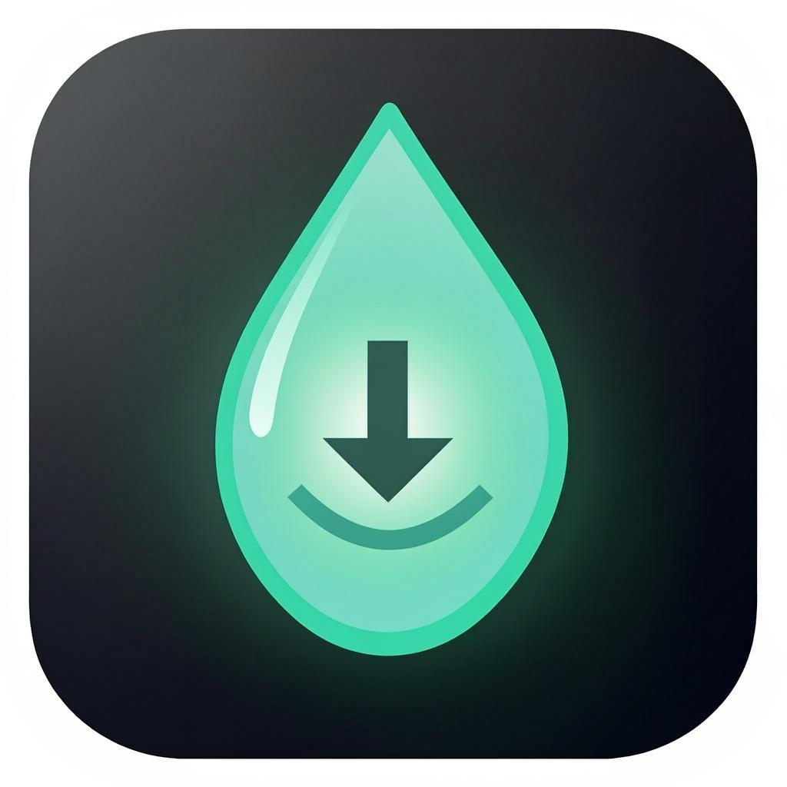

<p align="center">
  
</p>

<h1 align="center">DropShrink</h1>

<p align="center">
  <strong>فشرده‌ساز سریع و آفلاینِ ویدیو و تصویر</strong><br />
  <em>Fast, offline video &amp; image compressor</em>
</p>

<p align="center">
  <a href="https://github.com/SamRonin/dropshrink/actions/workflows/build.yml"></a>
  <a href="https://github.com/SamRonin/dropshrink/releases"></a>
  <a href="https://github.com/SamRonin/dropshrink/blob/main/LICENSE"></a>
  
  
</p>

<p align="center">
  <a href="README.en.md">English</a> · <strong>فارسی</strong>
</p>

<div dir="rtl">

## 📦 معرفی

**DropShrink** یک برنامه دسکتاپ برای **ویندوز، مک و لینوکس** است که فشرده‌سازی ویدیو و تصویر را به یک «بکشید و رها کنید» ساده تبدیل می‌کند. موتور پردازش آن **FFmpeg** است که کاملاً روی سیستم خودتان اجرا می‌شود؛ یعنی هیچ فایلی هیچ‌وقت از کامپیوتر شما خارج نمی‌شود.

کافی است فایل حجیم را در پنجره رها کنید، یک پریست انتخاب کنید (مثلاً «مخصوص تلگرام») و چند لحظه بعد خروجی سبک‌شده را تحویل بگیرید — همراه با نوار پیشرفت زنده، برآورد زمان باقی‌مانده و امکان لغو یا تلاش دوباره برای هر فایل.

## ✨ چرا DropShrink؟

- **۱۰۰٪ آفلاین و خصوصی** — نه درخواست شبکه، نه تلمتری، نه ثبت‌نام و حساب کاربری؛ همه‌چیز با FFmpeg روی دستگاه خودتان پردازش می‌شود.
- **بدون پیچیدگی خط فرمان** — نیازی نیست مفاهیمی مثل کدک و CRF را بدانید؛ سه پریست آماده برای موقعیت‌های واقعی کافی است.
- **صف پردازش واقعی** — چند فایل را یک‌جا رها کنید و بقیه‌اش با DropShrink؛ پردازش موازیِ کنترل‌شده، سرعت را بالا نگه می‌دارد.
- **حذف متادیتا با یک کلید** — اطلاعات دوربین و موقعیت مکانی (EXIF/GPS) از خروجی پاک می‌شوند.
- **دوزبانه** — فارسی (راست‌به‌چپ) و انگلیسی، با تشخیص خودکار زبان سیستم و فونت‌های همراه برنامه (کاملاً آفلاین).

## 📸 تصاویر

> 🚧 اسکرین‌شات‌ها و دموی برنامه به‌زودی اضافه می‌شوند 🙂

## 🚀 ویژگی‌ها

- 🖱️ درگ‌واندراپ دسته‌ای + انتخاب فایل با میانبر
- 🎞️ سه پریست ویدیو و سه پریست تصویر
- 📊 نوار پیشرفت زنده، بر اساس خروجی `-progress` خود FFmpeg: درصد پیشرفت، ETA، فریم‌برثانیه و بیت‌ریت
- ⏯️ برای هر فایل: لغو، تلاش دوباره و «نمایش در پوشه»
- ⚙️ پردازش موازی کنترل‌شده (۱ تا ۸ پردازش همزمان)
- 🧾 نام‌گذاری خروجی به شکل `ds-<نام-فایل>` کنار فایل اصلی یا در پوشه دلخواه
- 🔒 حذف متادیتا (EXIF و GPS)
- ⚡ شتاب‌دهی سخت‌افزاری — تشخیص خودکار انکودرهای GPU (NVIDIA NVENC ، Intel QSV ، VAAPI ، VideoToolbox) با بازگشت خودکار به CPU در صورت خطا
- 🔍 پیش‌نمایش و مقایسه — اسلایدر قبل/بعد یا مقایسه کنار هم برای تصویر و ویدیو، به‌همراه پخش هم‌زمان دو ویدیو
- 🛡 نگهبان حجم — اگر خروجی از ورودی بزرگ‌تر شود، فایل حذف و به کاربر هشدار داده می‌شود
- 🌐 فارسی و انگلیسی با پشتیبانی کامل RTL/LTR
- ⌨️ میانبرهای صفحه‌کلید برای کارهای پرتکرار

## 🎮 پریست‌ها

### ویدیو

| پریست | کدک ویدیو | کیفیت | حداکثر ابعاد | صدا | نکته |
| --- | --- | --- | --- | --- | --- |
| 📱 مخصوص تلگرام | H.264 (libx264) | CRF 24 | ۱۲۸۰ پیکسل ‹۱› | AAC 128k | حداکثر ۳۰ فریم بر ثانیه + فست‌استارت (`-movflags +faststart`) برای پخش آنی |
| 🌐 اشتراک‌گذاری وب | H.264 (یا VP9) | CRF 25 (VP9: CRF 32) | ۱۰۸۰p | AAC 96k (VP9: Opus) | کدک وب از تنظیمات قابل تغییر به VP9 است؛ خروجی VP9 با فرمت `.webm` |
| 🗄 حداکثر فشرده‌سازی | H.265/HEVC (libx265) | CRF 32 | اندازه اصلی | AAC 64k مونو | کمترین حجم با کیفیت دیداری خوب؛ اگر `libx265` در دسترس نباشد، خودکار به H.264 با CRF 28 برمی‌گردد |

‹۱› در ویدیوهای عمودی (پرتره)، سقف ۱۲۸۰ پیکسل روی ضلع عمودی اعمال می‌شود.

### تصویر

| پریست | فرمت خروجی | کیفیت | حداکثر ابعاد |
| --- | --- | --- | --- |
| 📱 مخصوص تلگرام | JPEG | ≈۸۰ | ۱۲۸۰ پیکسل |
| 🌐 اشتراک‌گذاری وب | WebP | ≈۷۸ | ۱۹۲۰ پیکسل |
| 🗄 حداکثر فشرده‌سازی | WebP | ≈۵۵ | ۱۶۰۰ پیکسل |

## ⬇️ دانلود و نصب

آخرین نسخه را از [صفحه Releases](https://github.com/SamRonin/dropshrink/releases) دانلود و نصب کنید:

| سیستم‌عامل | بسته |
| --- | --- |
| 🪟 ویندوز | نصب‌گر MSI / EXE |
| 🍎 مک (Apple Silicon) | DMG |
| 🍎 مک (Intel) | DMG |
| 🐧 لینوکس | AppImage / DEB |

### نصب FFmpeg

از نسخهٔ فعلی، باینری‌های FFmpeg/FFprobe **همراه خود برنامه باندل می‌شوند** (Sidecar) و معمولاً نیازی به نصب جداگانه نیست. در غیر این صورت DropShrink هنگام اجرا، FFmpeg را به این ترتیب پیدا می‌کند:

1. باینری‌های Sidecar همراه برنامه (`ffmpeg-<پلتفرم>` کنار فایل اجرایی)
2. پوشه `binaries/` کنار برنامه نصب‌شده (حالت پرتابل — می‌توانید `ffmpeg` و `ffprobe` را خودتان آنجا بگذارید)
3. پوشه منابع برنامه (resources)
4. `PATH` سیستم
5. مسیرهای رایج نصب (مانند `C:\ffmpeg\bin`، `/opt/homebrew/bin`، `/usr/local/bin` و…)
6. پوشه‌ای که خودتان در تنظیمات («پوشهٔ FFmpeg») مشخص می‌کنید

اگر FFmpeg روی سیستم شما نصب نیست، یکی از دستورهای زیر را اجرا کنید:

```bash
# ویندوز (PowerShell)
winget install Gyan.FFmpeg
# یا: دانلود از ffmpeg.org و افزودن به PATH

# macOS
brew install ffmpeg

# لینوکس (دبیان/اوبونتو)
sudo apt install ffmpeg
# یا معادل آن در توزیع خودتان
```

بعد از نصب، برنامه را یک بار ببندید و دوباره باز کنید.

## 💡 نحوه استفاده

1. فایل‌های ویدیو یا تصویر را بکشید و در پنجره رها کنید (یا `Ctrl/Cmd+O`).
2. پریست مناسب را انتخاب کنید — «تلگرام»، «وب» یا «حداکثر فشرده‌سازی».
3. پیشرفت هر فایل را دنبال کنید؛ در میانه راه می‌توانید پردازش را لغو کنید، فایل خطاداده را دوباره اجرا کنید یا خروجی را در پوشه نمایش دهید.
4. خروجی با نام `ds-<نام-فایل>` کنار فایل اصلی (یا در پوشه خروجی انتخابی شما) ذخیره می‌شود.

فرمت‌های رایج پشتیبانی می‌شوند: MP4، MKV، MOV، WebM برای ویدیو؛ JPG، PNG، WebP برای تصویر.

### ⌨️ میانبرها

| میانبر | کار |
| --- | --- |
| `Ctrl/Cmd + O` | انتخاب فایل |
| `Ctrl/Cmd + ,` | باز کردن تنظیمات |
| `Ctrl/Cmd + L` | تغییر زبان (فارسی / English) |

## 🛠 تنظیمات

| تنظیم | توضیح | پیش‌فرض |
| --- | --- | --- |
| پردازش‌های همزمان | تعداد فایل‌هایی که هم‌زمان انکود می‌شوند (۱ تا ۸) | تقریباً نصف هسته‌های CPU |
| کدک پریست وب | H.264 (انکود سریع‌تر) یا VP9 (حجم کمتر، انکود کندتر، خروجی WebM) | H.264 |
| پوشه خروجی | ذخیره کنار فایل اصلی یا انتخاب پوشه دلخواه | کنار فایل اصلی |
| حذف متادیتا | پاک‌کردن EXIF، موقعیت مکانی و سایر داده‌های شخصی از خروجی؛ در حالت غیرفعال، متادیتا با `-map_metadata 0` به خروجی منتقل می‌شود | فعال |
| شتاب‌دهی سخت‌افزاری | انکود ویدیو روی GPU در صورت وجود انکودر سالم (NVENC/QSV/VAAPI/VideoToolbox) | فعال (در صورت موجود بودن) |
| پوشهٔ FFmpeg | مسیر دستی پوشه‌ای شامل ffmpeg و ffprobe، فقط وقتی نسخهٔ همراه یا سیستمی پیدا نشود | تشخیص خودکار |

## 🔒 حریم خصوصی

- هیچ درخواست شبکه‌ای، هیچ تلمتری، هیچ حساب کاربری — هیچ‌جا، هیچ‌وقت.
- تمام پردازش‌ها با FFmpeg روی دستگاه شما انجام می‌شود؛ فایل‌های شما هرگز از کامپیوتر خارج نمی‌شوند.
- با فعال‌کردن «حذف متادیتا»، اطلاعات دوربین و موقعیت مکانی از خروجی پاک می‌شوند.
- حتی فونت‌ها (وزیرمتن و Inter) همراه برنامه باندل شده‌اند تا هیچ‌چیز از اینترنت بارگذاری نشود.

## 🧱 ساخت از سورس

پیش‌نیازها:

- **Rust** (نسخه stable، از طریق [rustup](https://rustup.rs))
- **Node.js ≥ 18** + npm
- فقط در لینوکس، وابستگی‌های وب‌کیت:

```bash
sudo apt install libwebkit2gtk-4.1-dev build-essential curl wget file \
  libxdo-dev libssl-dev libayatana-appindicator3-dev librsvg2-dev
```

سپس:

```bash
git clone https://github.com/SamRonin/dropshrink.git
cd dropshrink
npm install
bash scripts/fetch-binaries.sh   # دانلود باینری‌های Sidecar برای پلتفرم شما (ویندوز: scripts/fetch-binaries.ps1)
npm run tauri dev    # اجرا در حالت توسعه
npm run tauri build  # ساخت نصب‌گرها
```

نصب‌گرهای خروجی در مسیر `src-tauri/target/release/bundle/` قرار می‌گیرند.

## 🏗 معماری

```
dropshrink/
├── src/                  # React frontend (components, hooks, i18n, store)
├── src-tauri/
│   ├── src/              # Rust: ffmpeg detection/probing/presets/progress + queue scheduler
│   ├── capabilities/     # Tauri v2 capability permissions
│   └── icons/
├── .github/workflows/    # CI: multi-platform builds & releases
└── ...
```

## 🗺 نقشه راه

- [ ] تم روشن
- [ ] زبان‌های بیشتر
- [ ] پریست صوتی
- [ ] رابط سفارشی‌سازی پریست‌ها
- [ ] جابه‌جایی ترتیب فایل‌های صف با درگ
- [ ] پشتیبانی از HEIC
- [ ] افزودن فایل از منوی «Send to» در ویندوز

## 🛟 عیب‌یابی

### «FFmpeg پیدا نشد»

- مطابق بخش [نصب FFmpeg](#نصب-ffmpeg)، FFmpeg را نصب کنید و برنامه را دوباره باز کنید.
- اگر می‌خواهید برنامه وابستگی به PATH نداشته باشد، `ffmpeg` و `ffprobe` را در پوشه `binaries/` کنار برنامه نصب‌شده بگذارید (حالت پرتابل).
- منبع و نسخه FFmpeg شناسایی‌شده در پایین پنجره برنامه نمایش داده می‌شود.

### انکود کند است

- تعداد «پردازش‌های همزمان» را در تنظیمات تغییر دهید: عدد بیشتر یعنی توان عملیاتی بالاتر، عدد کمتر یعنی فن آرام‌تر و سیستم خنک‌تر.
- کدک‌های VP9 و H.265 ذاتاً کندتر از H.264 انکود می‌شوند؛ اگر سرعت اولویت است، پریست «وب» با H.264 یا پریست «تلگرام» را انتخاب کنید.

### خروجی «حداکثر فشرده‌سازی» (HEVC) پخش نمی‌شود

- پلیرهای قدیمی معمولاً HEVC را پشتیبانی نمی‌کنند؛ یک پلیر به‌روز (مثل VLC) نصب کنید یا از پریست «اشتراک‌گذاری وب» استفاده کنید.

### محدودیت‌های شناخته‌شده

- فایل‌های GIF به‌صورت تصویر ثابت پردازش می‌شوند و انیمیشن آن‌ها حفظ نمی‌شود.
- پشتیبانی از HEIC/AVIF به بیلد FFmpeg نصب‌شده روی سیستم شما بستگی دارد.

## 🤝 مشارکت

مشارکت‌ها خوش‌آمدند! 🎉 راهنمای کامل راه‌اندازی محیط توسعه و قواعد ارسال تغییرات را در [CONTRIBUTING.md](CONTRIBUTING.md) بخوانید. گزارش باگ و پیشنهاد ویژگی را از قالب‌های آماده Issue در مخزن ثبت کنید.

## 📄 مجوز

این پروژه تحت مجوز **MIT** منتشر می‌شود — جزئیات در [LICENSE](LICENSE).

## ❤️ قدردانی

ساخته‌شده روی دوش غول‌ها:

- [FFmpeg](https://ffmpeg.org) — موتور پردازش
- [Tauri](https://tauri.app) — چارچوب اپ دسکتاپ
- [React](https://react.dev) + [Tailwind CSS](https://tailwindcss.com) — رابط کاربری
- فونت [وزیرمتن](https://github.com/rastikerdar/vazirmatn) — تایپوگرافی فارسی
- [Lucide](https://lucide.dev)، [Framer Motion](https://www.framer.com/motion/)، [Zustand](https://github.com/pmndrs/zustand) — آیکون، انیمیشن و مدیریت وضعیت

</div>
